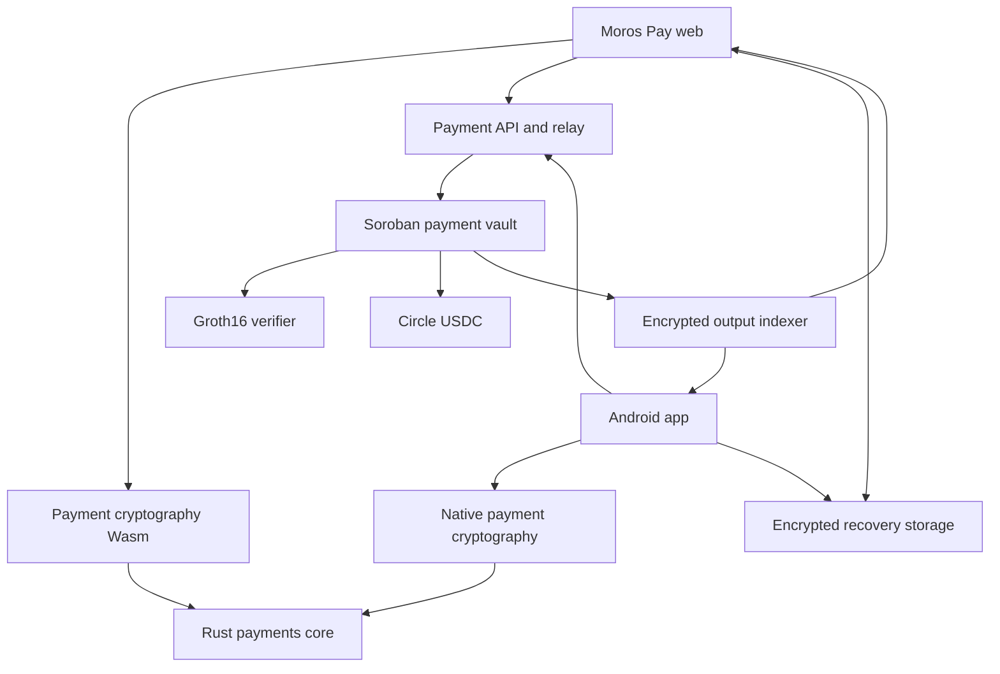

<p align="center"></p>

# Moros

Payments and financial infrastructure on Stellar, settled in Circle USDC.

[Website](https://moros.fun) | [Payment app](https://moros.fun/app) | [X](https://x.com/morosxyz)

Moros brings reusable private USDC balances, signed payment requests, encrypted recovery, and verifiable settlement to Stellar. Moros Pay is the web application, supported by shared contracts, cryptography, payment services, and client libraries that other applications can integrate.

The platform is expanding toward standard USDC transfers and optional partner-supported USDC-to-INR UPI merchant payments. These services are independently optional. The Android application is under development.

## Product capabilities

| Capability | Implementation |
| --- | --- |
| Private USDC balances | Shield once and reuse encrypted notes across payments |
| Private transfers | Recipient payment codes, encrypted outputs, and zero-knowledge value conservation |
| Signed payment requests | Fixed or open amounts, recipient verification, and expiration |
| Recovery | User-controlled recovery phrases and encrypted cross-device archives |
| Payment history | Locally decrypted transfers, requests, and receipts |
| Stellar wallet connection | Connect an existing wallet to fund the private balance |
| Withdrawals | Withdraw private USDC to a Stellar account |
| Developer infrastructure | Shared contracts, a Rust cryptography core, Wasm bindings, and a payment client library |
| Android | Native payment and recovery integration under development |
| Standard USDC transfers | Planned |
| USDC-to-INR UPI payments | Planned partner integration |

## Mainnet deployment

| Component | Stellar mainnet contract |
| --- | --- |
| Payment vault | [CCKD5AHU2JGUR7RWMI5CT3UVOOCPDTQYK43DI24GKRKKUWZ3N22UOAIR](https://stellar.expert/explorer/public/contract/CCKD5AHU2JGUR7RWMI5CT3UVOOCPDTQYK43DI24GKRKKUWZ3N22UOAIR) |
| Payment verifier | [CB4L4FGBRY2D53MYETJH45OVFWCXRBJEHTW7B4W56XROQ26VSHQPSPR5](https://stellar.expert/explorer/public/contract/CB4L4FGBRY2D53MYETJH45OVFWCXRBJEHTW7B4W56XROQ26VSHQPSPR5) |
| Circle USDC Stellar Asset Contract | [CCW67TSZV3SSS2HXMBQ5JFGCKJNXKZM7UQUWUZPUTHXSTZLEO7SJMI75](https://stellar.expert/explorer/public/contract/CCW67TSZV3SSS2HXMBQ5JFGCKJNXKZM7UQUWUZPUTHXSTZLEO7SJMI75) |

The vault and verifier are Moros deployments. Circle USDC is the existing settlement asset.

- [Mainnet deployment](deployments/payments-mainnet.json)
- [Mainnet proving manifest](deployments/payments-mainnet-proving.json)
- [Testnet deployment](deployments/payments-testnet.json)

These records describe existing deployments and their accepted proving artifacts. Repository maintenance does not rotate keys, replace contracts, or regenerate proving keys.

## Architecture



Clients construct notes and generate proofs locally. Contracts verify authorization, conservation, commitments, nullifiers, and replay protection. The relay submits authorized payment actions, the indexer discovers encrypted outputs, and recovery services store ciphertext. Decryption keys remain under user control.

## Payment flow

1. Connect a Stellar wallet and create or restore a private payment identity.
2. Add Circle USDC to the private balance.
3. Enter a recipient payment code or open a signed payment request.
4. Verify the recipient, amount, network, and expiry locally.
5. Generate the proof and authorize payment settlement.
6. Reuse received private USDC or withdraw it to a Stellar account.

New signed request links use `https://moros.fun/pay#...`. Existing links from `pay.moros.fun` remain accepted. The signed payload stays in the URL fragment.

## Repository structure

```text
moros/
  apps/
    pay-web/                Payment website and web application
    android/                Android app under development
  contracts/
    payment-types/          Payment statements and cryptographic primitives
    payment-vault/          Shielded USDC vault
    payment-verifier/       Groth16 verifier
    payment-circuits/       Seven payment circuits and their shared primitives
  crates/
    payments-core/          Key derivation, notes, requests, receipts, and recovery
    payments-core-wasm/     Browser bindings
    payments-mobile-native/ Android native bindings under development
  packages/
    payments-client/        Payment service client and deployment validation
    payments-crypto-web/    Generated Wasm package
  circuits/
    common/                 Groth16 artifact serialization
    payments/               Build tooling and circuit fixtures
  services/                 Payment APIs, relay, indexing, recovery, and RPC
  deployments/              Public payment deployment records
  supabase/                 Encrypted payment recovery schema
```

## Local development

Use Node.js 22 or later and the package versions pinned by each lockfile.

```bash
npm --prefix apps/pay-web ci
npm --prefix apps/pay-web run dev -- --port 3001
```

The web app reads its deployment from `apps/pay-web/config/`. `NEXT_PUBLIC_PAYMENT_DEPLOYMENT` can supply an explicit deployment configuration. Public URLs are configurable through `NEXT_PUBLIC_BRAND_URL` and `NEXT_PUBLIC_PAY_URL`.

```bash
npm --prefix services ci
npm --prefix services test
npm --prefix packages/payments-client ci
npm --prefix packages/payments-client test
npm --prefix circuits ci
npm --prefix circuits run test:payments
cargo test --manifest-path contracts/Cargo.toml --workspace
```

Circuit witness checks require Circom. Read [service setup](services/README.md) and [contract structure](contracts/README.md) before running deployment commands.

## Operations and key ownership

Service configuration, deployer identities, deployment state, and recovery secrets stay outside Git. Keep owner-only backups of Stellar identity files, environment configuration, local deployment state, and proving manifests. Preserve the same identity names and key material when moving an installation.

Production hosting serves the payment app from `apps/pay-web`. The payment API, encrypted recovery, indexer, and shared Stellar RPC are independently operated services. See [operations](services/OPS.md).
